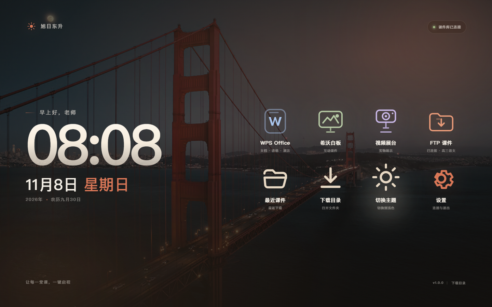
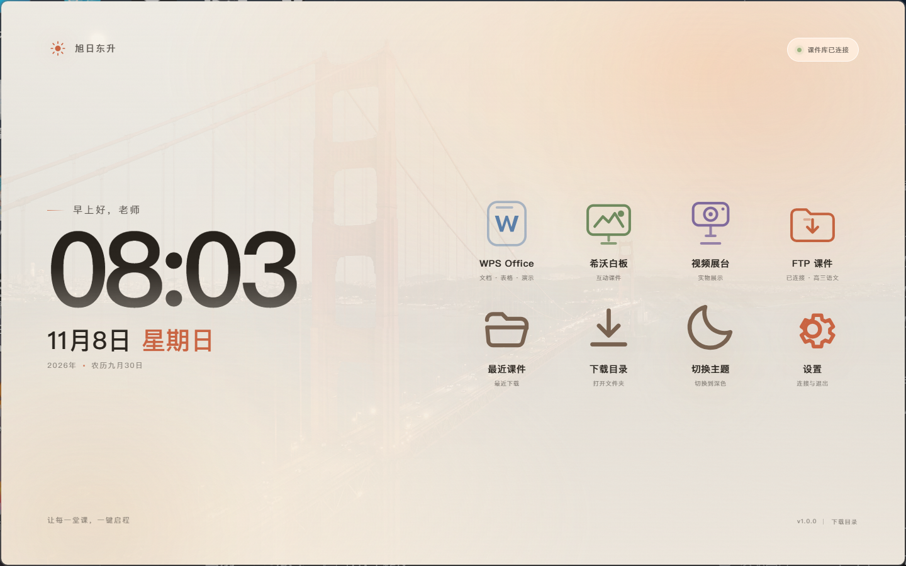
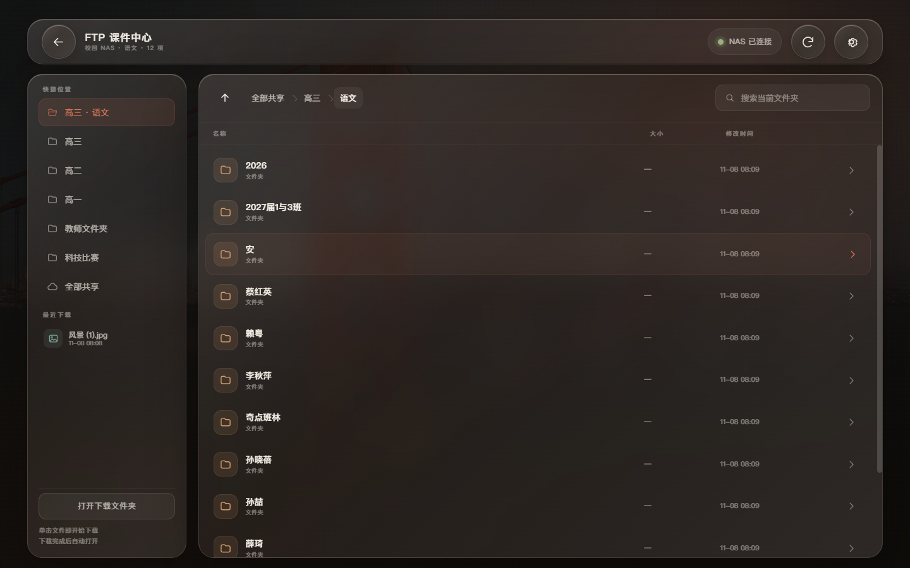
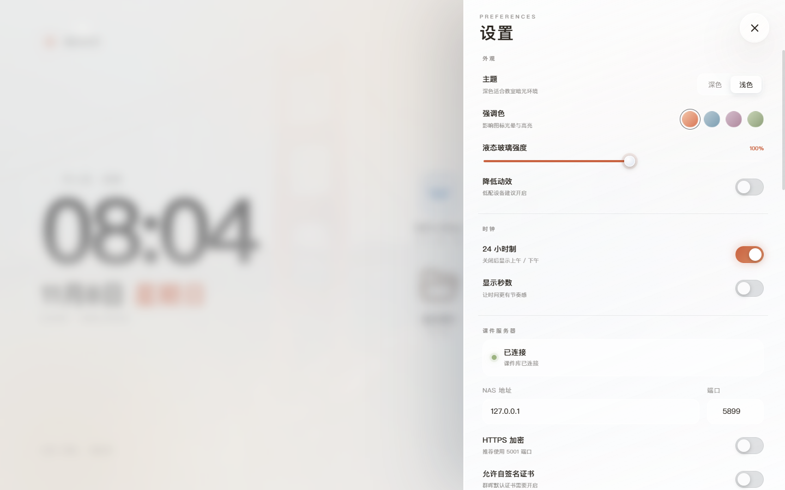

# 旭日东升 · Sunrise Launcher

> 为希沃 MT71A-SHG 教学一体机（Windows 10 x64）打造的全屏无障碍桌面启动器。
>
> 让每一堂课，一键启程。


## 这是什么

「旭日东升」是一个运行在 Windows 10 上的 Electron 桌面启动器，面向教室触摸大屏。它启动后强制全屏，并通过 Win32 API 完全隐藏 Windows 任务栏，让整块屏幕都成为课堂入口：

- 双击打开即全屏，任务栏完全隐藏（不是自动隐藏）
- 黑底开场动画，点出「旭日东升」、用途与共同创作者
- 左栏：问候语、超大时间、苹果设备风格的日期
- 右栏：所有入口以同等规格排列，直接浮在壁纸上，没有卡片衬底
- WPS、希沃白板、希沃视频展台一键启动
- 内置 FTP / NAS 课件浏览器，默认进入 `高三 / 语文`
- 单击课件即下载到本地下载文件夹，下载完成后按文件类型自动打开
- 移动存储设备：U 盘插入后图标点亮，内置与 FTP 课件中心同设计语言的双向拷贝浏览器，方便学生在一体机上互相拷课件
- 设置抽屉集中管理外观、时钟、熄屏、NAS、下载与自动打开；退出软件也藏在设置里
- 深色 / 浅色两套 Claude 风格的暖白 + 赤陶橙配色，主题切换在设置里完成
- 类 iPhone 自动熄屏常显（AOD）：无操作一段时间后壁纸亮度降至约四分之一（壁纸仍清晰可辨，不是纯黑），时钟居于屏幕正中、公历 / 农历日期紧贴其上，进 / 出熄屏带淡入淡出 + 轻微缩放动画，轻点任意位置唤醒（v1.9.0 新增，v1.9.5 改进压暗方式与动画，默认关闭）
- 深色 / 浅色模式各自独立的自定义壁纸与遮罩强度，两套遮罩调到 0 时都能看到无遮罩的原壁纸（v1.9.0 新增）
- 纯半透明无模糊面板（v1.4 起去掉 backdrop-filter；v1.5 进一步极致轻量：无渐变叠层、无噪点、无装饰动画，4K 下滚动依旧流畅）





## 核心体验

### 1. 真正的全屏与任务栏隐藏，以及「无模糊纯半透明」性能优化

启动器不是简单地设置 `fullscreen: true`，而是：

1. 创建无边框全屏窗口；
2. 通过 `user32.dll` 的 `FindWindow("Shell_TrayWnd")`、`FindWindowEx("Shell_SecondaryTrayWnd")` 与 `ShowWindow(SW_HIDE)` 隐藏主屏和副屏任务栏；
3. 由独立的 PowerShell 守护进程每 700ms 检查一次，防止 Explorer 重启后任务栏重新出现；
4. 正常退出时写入停止标记，守护进程调用 `ShowWindow(SW_SHOW)` 恢复任务栏。

> 任务栏隐藏是强制的，设置中不提供关闭选项。软件不能通过 Alt+F4、关闭按钮或任务管理器以外的方式退出；正常退出路径只有「设置 → 退出旭日东升」。

**v1.4 性能改造**：1080p 下流畅、4K 下卡顿的元凶是玻璃面板的 `backdrop-filter` 模糊——它要求 GPU 在每一帧滚动时对整块面板背后重新采样模糊。v1.4 把全部界面改为「纯半透明无模糊」：

- 删除所有 `backdrop-filter`（面板、抽屉、弹窗、Toast、预览器、遮罩）；
- 删除装饰性 `filter: blur()`（环境光晕、开场动画、悬停光晕），用径向渐变自然过渡；
- 分辨率保持不变，清晰度没有任何损失，只是不再让 GPU 做模糊；
- 设置里的「半透明强度」滑杆改为控制面板底色不透明度（35%–160%），仍然可以微调玻璃观感。

**v1.5 极致轻量**：在 v1.4 基础上把装饰性视觉全部拆掉，只留纯色半透明与必要的功能反馈：

- 删除环境光球、噪点遮罩、壁纸漂移动画、主界面逐项入场动画、列表逐行淡入动画、骨架屏流光；
- 玻璃面板改为单层纯半透明底色（无渐变叠层、无内描边高光、无噪点覆盖层），按钮全部扁平纯色；
- 时钟去掉渐变文字与投影，图标去掉 drop-shadow 光晕，悬停不再位移缩放；
- 所有过渡缩短到 0.15–0.28s，且只过渡透明度 / 颜色，不过渡阴影与位移，滚动列表不再平滑滚动；
- 修复：USB 对拷界面勾选文件时整张列表会「重新淡入」一次的问题（现在只更新勾选行本身）。

### 2. 左时间，右入口

- 左栏：`早上好，丁老师`、超大时间、`11月8日 星期日`（苹果设备风格的大号日期）、年份与农历。
- 右栏：8 个同尺寸入口，全部无卡片衬底、直接浮于壁纸：
  - WPS Office
  - 希沃白板
  - 视频展台
  - FTP 课件
  - 最近课件
  - 下载目录
  - 移动存储设备（未插 U 盘时置灰，插入后点亮）
  - 设置
- 右栏下方：四个图标宽的「最近课件」列表，每行一个课件，最多显示三行，更多可向下滚动；点击即可再次打开课件、视频等资源。

### 3. FTP / NAS 课件库

课件服务器是校园内的群晖 NAS（默认 `10.82.58.2`）。启动器没有把 DSM 网页嵌进来，而是自己实现了一个适合触摸屏的文件浏览器：

- 默认路径：`/高三/语文`
- 单击文件夹进入，单击文件立即下载
- 面包屑、上一级、快捷位置、当前文件夹搜索、刷新
- 左上角返回桌面；设置里可修改 NAS 地址、端口、HTTPS、自签名证书与默认路径
- 文件夹优先排序，显示大小与修改时间，按文件类型显示图标



### 3.5 移动存储设备（v1.4 新增）

为方便不会操作电脑的同学在一体机上拷课件，主界面新增「移动存储设备」入口：

- 没插 U 盘时图标置灰不可点击；插入 U 盘后约 4 秒内自动点亮（后台每 4 秒轮询一次可移动磁盘）；
- 点开是一个与 FTP 课件中心设计语言完全一致的内置文件浏览器，左右分栏：
  - 左侧「本机课件」：下载文件夹与桌面两个位置可切换，只显示课程类资源（PPT/PPTX/ENBX、Word、Excel、PDF、图片、音视频、压缩包等）；子文件夹点击进入次级界面，不会把所有子文件夹里的文件铺开；
  - 右侧「U 盘」：显示 U 盘里的全部文件（不只课件类），同样可以进入文件夹；
- 单击文件即选中，可多选；两侧各有「全选 / 清除」与拷贝按钮，支持双向拷贝（本机 → U 盘，U 盘 → 桌面）；
- 拷贝时底部弹出进度条（当前文件、总体进度、速度、剩余），可以随时取消；同名文件自动加「 (1)」后缀，不会覆盖；
- 从 U 盘拷入本机的文件固定保存到**桌面**（v1.5）：只拷一个文件时按类型自动打开（VLC / WPS / 内置看图），拷多个文件时自动打开桌面文件夹；中缝双向装饰图标已移除，界面更轻。

### 3.6 自动熄屏常显（v1.9.0 新增，v1.9.5 改进）

模仿 iPhone 的 Always-on Display：设置里手动开启（默认关闭）后，软件在一段可配置的时间内检测不到任何键鼠 / 触摸操作，就把壁纸亮度降到约四分之一，画面只剩一组位于中间偏上的内容：

- 大号数字时钟位于屏幕正中（跟随「24 小时制」设置），是整组画面的锚点；
- 时钟正上方紧贴两行日期，行距很紧：
  - 第一行：`2026年11月12日 星期四`（公历日期）
  - 第二行：`丙午年十月初四日`（干支纪年 + 汉字农历月日，由 Chromium 内置农历历法换算，跨春节自动切干支、闰月正确）
- 底部一行「轻点任意位置解锁」。

全部使用苹方（PingFang SC）字体，全部文字带统一的轻微透明度。轻点屏幕任意位置或按任意键立即唤醒。

v1.9.5 对熄屏观感做了两处升级：

- **压暗方式**：不再用近似纯黑的幕布盖住画面，而是把壁纸三层（壁纸 / 遮罩 / 装饰纱）整体压暗到约 22% 亮度，壁纸本身始终清晰可辨，两种主题下观感一致；
- **进 / 出动画**：进入熄屏时壁纸轻微放大（1.02 → 1.06 的呼吸感）并同步压暗，时钟内容以淡入 + 0.94 → 1 的轻微缩放浮现，底部提示延迟淡入；唤醒时壁纸缩放还原、亮度回升，整组内容干净利落地淡出。

细节：

- 空闲检测在主进程用 `powerMonitor.getSystemIdleTime()` 完成（系统级，统计所有窗口的输入）；即使老师正在用 WPS 放课件，熄屏也不会在背后悄悄挂起；
- 进入熄屏前等待时间可自定义，最短 30 秒，最长 15 分钟；
- 下载、U 盘拷贝等后台任务不受熄屏影响，唤醒后继续可见；
- 开启「降低动效」时熄屏切换改为快速淡入淡出。

### 3.7 深浅模式独立壁纸与白色遮罩（v1.9.0 新增）

- 深色模式与浅色模式各有一套独立的自定义壁纸（设置 → 外观 → 深色模式壁纸 / 浅色模式壁纸），切换主题时自动换用对应壁纸；旧版本的自定义壁纸升级后两套共用，不会丢失；
- 浅色模式的白色遮罩强度独立可调（背景遮罩 · 白色），不再像以前那样固定压低壁纸不透明度；
- 两种遮罩都调到 0% 时为「最通透」状态：都直接显示无遮罩的原壁纸，深浅模式完全一致。

### 4. 下载、监听与自动打开

下载不会在浏览器里直接打开，而是：

1. 优先通过群晖 FileStation `SYNO.FileStation.Download` 流式下载到下载目录的 `.sunrise-part` 临时文件；
2. 校验 HTTP 状态、`Content-Type` 与文件头（ZIP/PDF/JPEG/PNG/MP4 等），拒绝把 DSM 的 502 HTML 页面当成课件；
3. 如果 FileStation 不可用，自动回退到 SMB：`\\NAS\共享文件夹\路径`，通过 PowerShell 的 `New-SmbMapping` + `Copy-Item` 复制并校验大小；
4. 下载完成后重命名为正式文件，并写入「最近课件」；
5. 监听下载文件夹：无论是启动器下载的，还是老师从 U 盘/浏览器放进来的新文件，只要文件稳定出现，就按类型自动打开。

自动打开规则：

| 类型 | 打开方式 |
|---|---|
| 视频（mp4/mkv/avi/mov/wmv/flv/webm…） | VLC 全屏；没有 VLC 时回退 PotPlayer / 系统默认 |
| PPT / PPTX / PPS | `wps.exe /prometheus /wpp "文件"` |
| DOC / DOCX / WPS | `wps.exe /prometheus /wps "文件"` |
| XLS / XLSX / CSV | `wps.exe /prometheus /et "文件"` |
| PDF | `wps.exe /prometheus /pdf "文件"` |
| 图片 | 启动器内置图片查看器（双击放大、滚轮缩放、拖动） |
| 希沃课件（.enbx） | `swenlauncher.exe "文件" -m Display` |
| 压缩包 | 在资源管理器中定位 |
| 可执行文件 | 出于安全考虑不自动运行，只定位文件 |

### 5. 设置与退出



设置包含：

- 外观：深色/浅色（主题切换就在这里）、强调色、半透明强度、暖白光晕、深色 / 浅色模式独立壁纸与黑白两套遮罩、降低动效
- 时钟：24 小时制、显示秒数
- 熄屏常显：开关 + 进入熄屏前等待时间（最短 30 秒）
- 课件服务器：地址、端口、HTTPS、自签名证书、默认路径、测试连接
- 下载与打开：下载目录、自动打开总开关、按类型开关、视频播放器
- 系统：开机自启、防止屏幕休眠、跳过开场动画、显示最近课件
- 关于：版本、共同创作者、GitHub、日志、配置目录、诊断信息、恢复默认
- 退出：只有这里可以正常关闭软件

## 技术栈

- Electron 36（Windows 10 x64，打包为 NSIS 安装包与便携版）
- 原生 HTML / CSS / ES Modules，无前端构建步骤
- 主进程使用 Node.js 内置 `http` / `https` / `fs` / `child_process`，没有原生模块
- 农历 / 干支换算使用 Chromium 内置 `Intl` 中国传统历法，无额外依赖
- 自定义 `app://` 协议加载渲染层，启用 `contextIsolation` + `sandbox`，通过 preload 暴露最小 IPC
- 任务栏隐藏与 SMB 复制由 Windows PowerShell 5.1 辅助脚本完成
- 全局字体：平方简体（PingFang SC）；壁纸：macOS 27 Golden Gate（用户提供）

## 开发

环境要求：Windows 10/11，Node.js 20+，npm。

```powershell
npm install
npm run dev      # 启动模拟 NAS + Electron 窗口模式（不隐藏任务栏，方便调试）
npm start        # 以正式模式启动（全屏 + 隐藏任务栏）
npm run dist     # 打包 NSIS 安装包 + 便携版到 dist/

# 或者直接双击 / 运行一键构建脚本（自动安装依赖并打安装包）：
.\build.ps1
```

`npm run dev` 会：

- 启动 `tools/mock-nas.js`（默认 `127.0.0.1:5899`）
- 使用 `tools/mock-data/` 中的模拟课件
- 把下载目录指向 `tools/mock-downloads/`
- 强制 1x 缩放、窗口模式，便于截图与调试

> 开发环境若设置了 `ELECTRON_RUN_AS_NODE=1`，`tools/start.js` 与 `tools/dev.js` 会自动清除它，避免 Electron 被当成纯 Node 运行。

### 目录结构

```text
src/main/            Electron 主进程（窗口、任务栏、NAS、下载、IPC、配置、U 盘）
src/preload/         contextBridge 预加载脚本
src/renderer/        HTML / CSS / ES Modules 界面（含移动存储浏览器 usb-ui）
resources/scripts/   taskbar-guard.ps1 / smb-copy.ps1
build/               图标（PNG / ICO）
tools/               模拟 NAS、开发启动器、截图脚本、图标生成脚本
docs/                README 截图
build.ps1            一键构建安装版（自动 npm install + electron-builder）
```

## NAS 与凭据说明

- 启动器内置班级教师账号（用户名与密码不写入 README、日志或安装包外部配置），首次运行无需手动输入。
- 该账号只应拥有校内 NAS 的最小必要权限。
- FileStation 登录使用 `session=FileStation`；下载失败会自动尝试 SMB。
- NAS 地址、端口、HTTPS 与默认目录都可以在设置中修改。
- 不要把本安装包公开传播到校外；仓库中的凭据仅用于班级内网环境。

## 已知限制

- 目标机没有 Node.js / Python / .NET SDK，因此发布物必须是 electron-builder 打出的自包含安装包或便携版。
- NAS 的 `SYNO.FileStation.Download` 在部分 DSM/账号下会返回 502，此时依赖 SMB 通道；需要确保教师账号对目标共享目录有读权限。
- 便携版的开机自启可能受临时解压路径影响，建议使用 NSIS 安装版。
- 希沃白板、视频展台、WPS 的具体路径以现场采集环境记录为准（该记录不随仓库公开）；启动器会做候选路径探测。

## 致谢

- 设计与开发：**JHCWColin**
- AI 协作：**DeepSeek**
- 现场环境与 NAS 接口：现场采集环境记录（本地文档，不随仓库公开）
- 字体：平方简体（PingFang SC），来自老师提供的 `PingFang-main.zip`
- 壁纸：macOS 27 Golden Gate，老师提供

## License

代码以 MIT License 发布，详见 [LICENSE](LICENSE)。字体与壁纸的版权归各自权利人所有，不包含在 MIT 授权范围内，详见 [NOTICE](NOTICE)。
