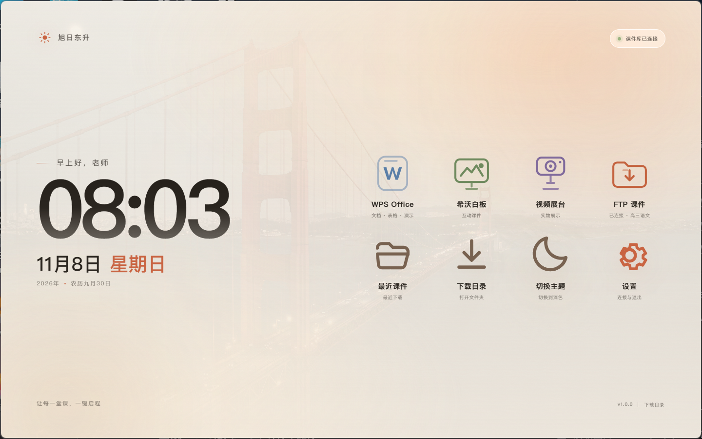
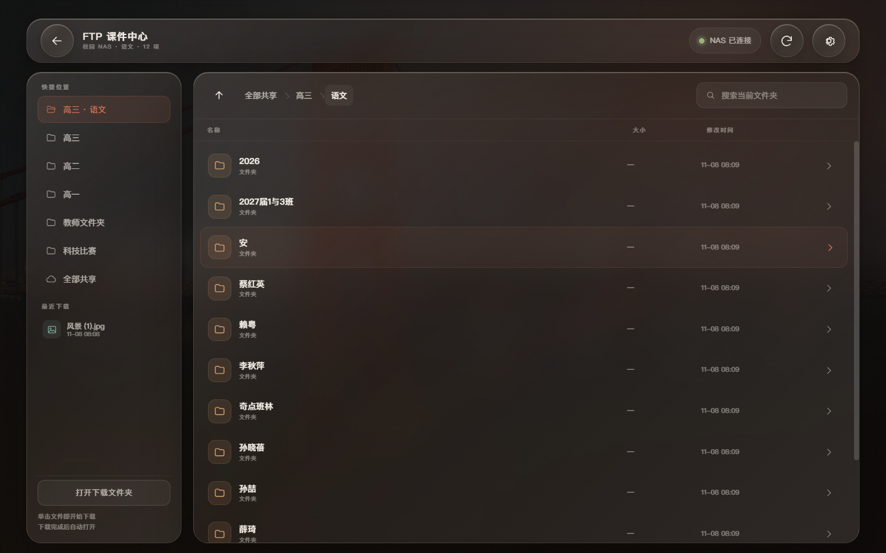
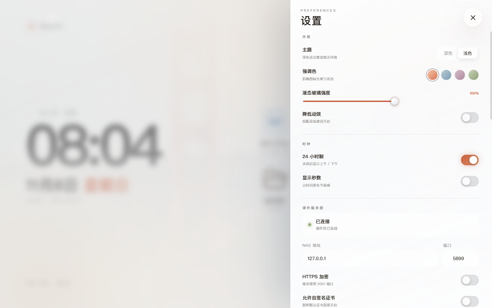

# 旭日东升 · Sunrise Launcher

> 为希沃 MT71A-SHG 教学一体机（Windows 10 x64）打造的全屏无障碍桌面启动器。
>
> 让每一堂课，一键启程。


## 这是什么

「旭日东升」是一个运行在 Windows 10 上的 Electron 桌面启动器，面向教室触摸大屏。它启动后强制全屏，并通过 Win32 API 完全隐藏 Windows 任务栏，让整块屏幕都成为课堂入口：

- 双击打开即全屏，任务栏完全隐藏（不是自动隐藏）
- 黑底开场动画，点出「旭日东升」、用途与开发者
- 左栏：问候语、超大时间、苹果设备风格的日期
- 右栏：所有入口以同等规格排列，直接浮在壁纸上，没有卡片衬底
- WPS、希沃白板、希沃视频展台一键启动
- 内置 FTP / NAS 课件浏览器，默认进入 `高三 / 语文`
- 单击课件即下载到本地下载文件夹，下载完成后按文件类型自动打开
- 设置抽屉集中管理外观、时钟、NAS、下载与自动打开；退出软件也藏在设置里
- 深色 / 浅色两套 Claude 风格的暖白 + 赤陶橙配色




## 核心体验

### 1. 真正的全屏与任务栏隐藏

启动器不是简单地设置 `fullscreen: true`，而是：

1. 创建无边框全屏窗口；
2. 通过 `user32.dll` 的 `FindWindow("Shell_TrayWnd")`、`FindWindowEx("Shell_SecondaryTrayWnd")` 与 `ShowWindow(SW_HIDE)` 隐藏主屏和副屏任务栏；
3. 由独立的 PowerShell 守护进程每 700ms 检查一次，防止 Explorer 重启后任务栏重新出现；
4. 正常退出时写入停止标记，守护进程调用 `ShowWindow(SW_SHOW)` 恢复任务栏。

> 任务栏隐藏是强制的，设置中不提供关闭选项。软件不能通过 Alt+F4、关闭按钮或任务管理器以外的方式退出；正常退出路径只有「设置 → 退出旭日东升」。

### 2. 左时间，右入口

- 左栏：`早上好，老师`、超大时间、`11月8日 星期日`（苹果设备风格的大号日期）、年份与农历。
- 右栏：8 个同尺寸入口，全部无卡片衬底、直接浮于壁纸：
  - WPS Office
  - 希沃白板
  - 视频展台
  - FTP 课件
  - 最近课件
  - 下载目录
  - 切换主题
  - 设置

### 3. FTP / NAS 课件库

课件服务器是校园内的群晖 NAS（默认 `10.82.58.2`）。启动器没有把 DSM 网页嵌进来，而是自己实现了一个适合触摸屏的文件浏览器：

- 默认路径：`/高三/语文`
- 单击文件夹进入，单击文件立即下载
- 面包屑、上一级、快捷位置、当前文件夹搜索、刷新
- 左上角返回桌面；设置里可修改 NAS 地址、端口、HTTPS、自签名证书与默认路径
- 文件夹优先排序，显示大小与修改时间，按文件类型显示图标



### 4. 下载、监听与自动打开

下载不会在浏览器里直接打开，而是：

1. 优先通过群晖 FileStation `SYNO.FileStation.Download` 流式下载到下载目录的 `.sunrise-part` 临时文件；
2. 校验 HTTP 状态、`Content-Type` 与文件头（ZIP/PDF/JPEG/PNG/MP4 等），拒绝把 DSM 的 502 HTML 页面当成课件；
3. 如果 FileStation 不可用，自动回退到 SMB：`\\NAS\共享文件夹\路径`，通过 PowerShell 的 `New-SmbMapping` + `Copy-Item` 复制并校验大小；
4. 下载完成后重命名为正式文件，并写入「最近课件」；
5. 监听下载文件夹：无论是启动器下载的，还是老师从 U 盘/浏览器放进来的新文件，只要文件稳定出现，就按类型自动打开。

自动打开规则：

| 类型 | 打开方式 |
|---|---|
| 视频（mp4/mkv/avi/mov/wmv/flv/webm…） | VLC 全屏；没有 VLC 时回退 PotPlayer / 系统默认 |
| PPT / PPTX / PPS | `wps.exe /prometheus /wpp "文件"` |
| DOC / DOCX / WPS | `wps.exe /prometheus /wps "文件"` |
| XLS / XLSX / CSV | `wps.exe /prometheus /et "文件"` |
| PDF | `wps.exe /prometheus /pdf "文件"` |
| 图片 | 启动器内置图片查看器（双击放大、滚轮缩放、拖动） |
| 希沃课件（.enbx） | `swenlauncher.exe "文件" -m Display` |
| 压缩包 | 在资源管理器中定位 |
| 可执行文件 | 出于安全考虑不自动运行，只定位文件 |

### 5. 设置与退出



设置包含：

- 外观：深色/浅色、强调色、液态玻璃强度、降低动效
- 时钟：24 小时制、显示秒数
- 课件服务器：地址、端口、HTTPS、自签名证书、默认路径、测试连接
- 下载与打开：下载目录、自动打开总开关、按类型开关、视频播放器
- 系统：开机自启、防止屏幕休眠、跳过开场动画、显示最近课件
- 关于：版本、开发者、GitHub、日志、配置目录、诊断信息、恢复默认
- 退出：只有这里可以正常关闭软件

## 技术栈

- Electron 36（Windows 10 x64，打包为 NSIS 安装包与便携版）
- 原生 HTML / CSS / ES Modules，无前端构建步骤
- 主进程使用 Node.js 内置 `http` / `https` / `fs` / `child_process`，没有原生模块
- 自定义 `app://` 协议加载渲染层，启用 `contextIsolation` + `sandbox`，通过 preload 暴露最小 IPC
- 任务栏隐藏与 SMB 复制由 Windows PowerShell 5.1 辅助脚本完成
- 全局字体：平方简体（PingFang SC）；壁纸：macOS 27 Golden Gate（用户提供）

## 开发

环境要求：Windows 10/11，Node.js 20+，npm。

```powershell
npm install
npm run dev      # 启动模拟 NAS + Electron 窗口模式（不隐藏任务栏，方便调试）
npm start        # 以正式模式启动（全屏 + 隐藏任务栏）
npm run dist     # 打包 NSIS 安装包 + 便携版到 dist/
```

`npm run dev` 会：

- 启动 `tools/mock-nas.js`（默认 `127.0.0.1:5899`）
- 使用 `tools/mock-data/` 中的模拟课件
- 把下载目录指向 `tools/mock-downloads/`
- 强制 1x 缩放、窗口模式，便于截图与调试

> 开发环境若设置了 `ELECTRON_RUN_AS_NODE=1`，`tools/start.js` 与 `tools/dev.js` 会自动清除它，避免 Electron 被当成纯 Node 运行。

### 目录结构

```text
src/main/            Electron 主进程（窗口、任务栏、NAS、下载、IPC、配置）
src/preload/         contextBridge 预加载脚本
src/renderer/        HTML / CSS / ES Modules 界面
resources/scripts/   taskbar-guard.ps1 / smb-copy.ps1
build/               图标（PNG / ICO）
tools/               模拟 NAS、开发启动器、截图脚本、图标生成脚本
docs/                README 截图
```

## NAS 与凭据说明

- 启动器内置班级教师账号（用户名与密码不写入 README、日志或安装包外部配置），首次运行无需手动输入。
- 该账号只应拥有校内 NAS 的最小必要权限。
- FileStation 登录使用 `session=FileStation`；下载失败会自动尝试 SMB。
- NAS 地址、端口、HTTPS 与默认目录都可以在设置中修改。
- 不要把本安装包公开传播到校外；仓库中的凭据仅用于班级内网环境。

## 已知限制

- 目标机没有 Node.js / Python / .NET SDK，因此发布物必须是 electron-builder 打出的自包含安装包或便携版。
- NAS 的 `SYNO.FileStation.Download` 在部分 DSM/账号下会返回 502，此时依赖 SMB 通道；需要确保教师账号对目标共享目录有读权限。
- 便携版的开机自启可能受临时解压路径影响，建议使用 NSIS 安装版。
- 希沃白板、视频展台、WPS 的具体路径以现场采集环境记录为准（该记录不随仓库公开）；启动器会做候选路径探测。

## 致谢

- 设计与开发：**溶液不呈电中性**
- AI 协作：**DeepSeek**
- 现场环境与 NAS 接口：现场采集环境记录（本地文档，不随仓库公开）
- 字体：平方简体（PingFang SC），来自老师提供的 `PingFang-main.zip`
- 壁纸：macOS 27 Golden Gate，老师提供

## License

代码以 MIT License 发布，详见 [LICENSE](LICENSE)。字体与壁纸的版权归各自权利人所有，不包含在 MIT 授权范围内，详见 [NOTICE](NOTICE)。
